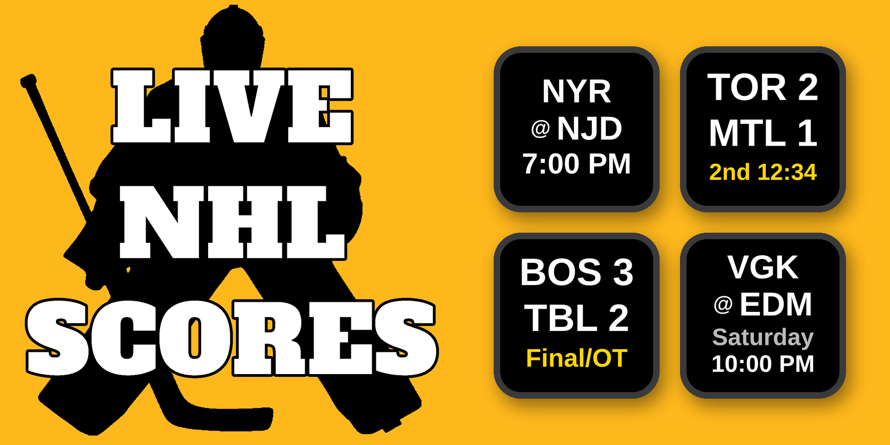
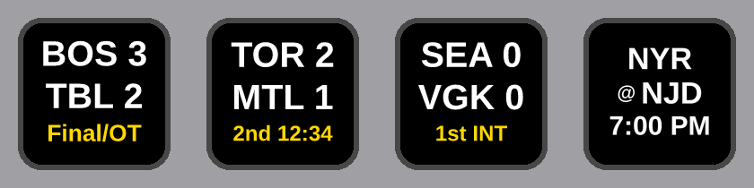
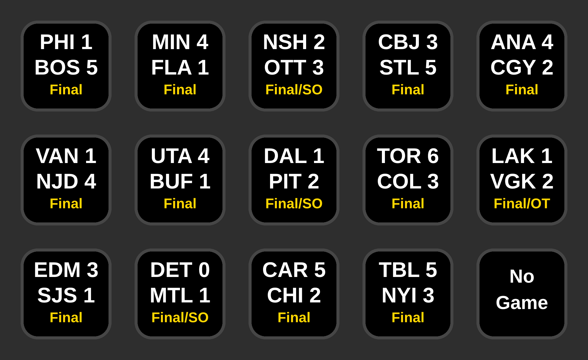
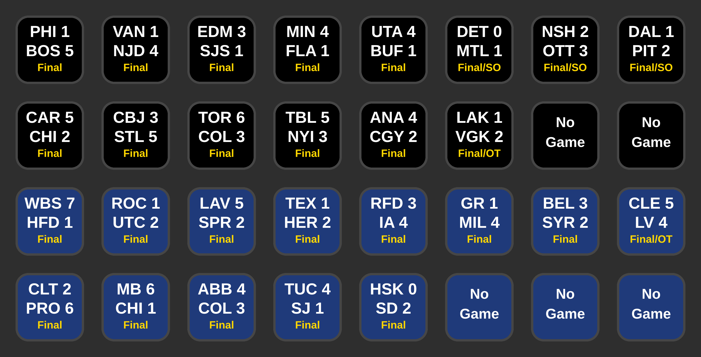

# Live NHL Scores — Stream Deck Plugin



A Stream Deck plugin that shows live hockey scores directly on your keys — **NHL, AHL, and ECHL**. Two actions: **Live NHL Scores** tracks one team per key, and **Live NHL Scoreboard** fills your keys with today's games for a league. Keys update automatically every 30 seconds.

  [](https://marketplace.elgato.com/product/live-nhl-scores-b463d273-9e52-4062-bfba-c30089b0c677)

---

## Features

- **Three leagues** — NHL, AHL, and ECHL, 94 teams total
- **Search by name or city** — type a team or location in the settings panel for instant results across all three leagues
- **Browse by league and division** — or pick a league, then a division, then a team from the dropdowns
- **Live scores** — shows away score, home score, and current period/time while a game is in progress
- **Pre-game** — the two teams stacked (`TOR` over `@ BOS`) and the start time; on off days, your team's next game with its day and time
- **Final scores** — shows the final score with a "Final", "Final/OT", or "Final/SO" label
- **Goal lamp** — when either team scores, the key plays a few seconds of red goal light on the scoring team's color; for NHL games it's followed by a short card with the team and type of goal (e.g. WSH / PPG +1 — EV, PPG, SHG, EN, PS), and for AHL/ECHL games a GOAL +1 card (on by default; turn it off per key in settings to get a quick solid flash in the scoring team's primary color instead)
- **Custom key background** — pick any color and opacity for the key background in settings
- **Custom link** — send key presses to any URL you choose instead of Gamecenter
- **Browser shortcut** — press any key to open that game's recap or gamecenter
- **No-flicker updates** — keys only redraw when the display actually changes
- **Multi-key support** — add as many team keys as you want, each refreshes independently
- **Live NHL Scoreboard action** — a second action that lays out today's games for the NHL, AHL or ECHL, one game per key, with the goal lamp on every goal. Different boards can live on different pages (or share one, each with its own background color)

---

## Recent Updates

**v1.2.2.0**
- Fixed: "today" is now read in Eastern time, which is how the NHL and AHL/ECHL date their games. Outside the US the keys could ask for tomorrow's slate while tonight's games were still on. The day now changes at 5:00 AM Eastern (2:00 AM Pacific), so late games and their finals stay on the keys overnight everywhere
- Far fewer requests: all your team keys and Scoreboards now share each feed instead of every key asking on its own
- If the NHL or AHL/ECHL feed stops responding for a moment, keys keep showing the last scores with a small amber dot instead of "Err" (after 10 minutes without an update they show "Err")
- Requires Stream Deck 7.1 or later

**v1.2.1.0**
- Pregame keys are easier to read: the teams stack on two lines (away team on top, "@ home" below, with a small "@") and the day and time get their own lines. On game day the day line goes away and the start time is shown larger. Same on team keys and Scoreboard keys
- Games a week or more out show the date on the day line ("Sat 10/24"), with the time underneath
- Off-day keys show your team's next game the same way: the "Next Game" label is gone, and the day line reads the weekday ("Thursday"), or the date when it's a week or more away
- AHL and ECHL start times now show in your own time zone, like NHL games (they used to show the arena's local time)
- The Scoreboard's next-game-day keys (no games today) use the same layout

**v1.2.0.0**
- New: **Live NHL Scoreboard** action — drag it onto as many keys as you like and they fill with today's games, one game per key, in start-time order. Pick the league for each board: **NHL** (up to 16 keys), **AHL** (up to 16) or **ECHL** (up to 15)
- Same keys as the team action: the goal lamp on the scoring team's color plus the goal card (NHL: EV / PPG / SHG / EN / PS +1; AHL/ECHL: GOAL +1), and fireworks at the final. The lamp can be turned off per board for a quick flash instead
- Each board remembers its own settings, so an NHL page and an AHL page work, and boards with different settings can share a page; give each board its own background color to tell them apart
- Fill top-to-bottom or left-to-right and optionally send finals to the end. More games than keys: the last key shows "+N more"; extra keys show "No Game". Both open the league's scores page
- The board moves to the next day at 2:00 AM, same as the team keys. On a day with no games (All-Star break, holidays), it shows the next game day's schedule with the day on each key
- Press a Scoreboard key to open that game's Gamecenter (AHL/ECHL: the official game report)

Older updates: see the full version history in [CHANGELOG.md](CHANGELOG.md).

---

## Requirements

- [Elgato Stream Deck](https://www.elgato.com/stream-deck) hardware
- [Stream Deck software](https://www.elgato.com/downloads) version 7.1 or later (Mac or Windows)
- No account required — the plugin uses each league's free public API

---

## Installation

**Elgato Marketplace (recommended)**

1. Open **[Live NHL Scores on the Elgato Marketplace](https://marketplace.elgato.com/product/live-nhl-scores-b463d273-9e52-4062-bfba-c30089b0c677)** and install it from there
2. The plugin will appear in the Stream Deck action picker under **Live NHL Scores**

**Manual install**

1. Download the latest **`Live NHL Scores.streamDeckPlugin`** from the [Releases](../../releases) page
2. Double-click the file — Stream Deck will install it automatically

---

## Setup

1. Drag the **Live NHL Scores** action onto any key
2. In the settings panel on the right, either:
   - Type your team's name or city into the search box and pick it from the results, or
   - Choose a league (NHL / AHL / ECHL), optionally a division, then your team from the dropdown
3. Press the key anytime to open that game's recap or gamecenter

That's it. The key will load your team's game within a few seconds and refresh every 30 seconds from there.

**Scoreboard:**

1. Drag the **Live NHL Scoreboard** action onto as many keys as you want. 16 keys fits any NHL night
2. In the settings panel, pick the league (NHL, AHL or ECHL), the fill order, whether finals move to the end, the goal lamp, and an optional background color. Changes apply to the whole board the key is part of

---

## What the Key Shows



**Before the game** (later in the week; the day is gray):
```
TOR
@ BOS
Thursday
7:00 PM
```

**Game day:**
```
TOR
@ BOS
7:00 PM
```

**Live game:**
```
TOR  2
BOS  1
2nd 14:22
```

**Overtime:**
```
TOR  2
BOS  1
OT 3:05
```

**Final score:**
```
TOR  2
BOS  1
Final
```

**Final (OT/SO):**
```
TOR  2
BOS  1
Final/OT
```

**Off day** (your team's next game — the weekday, or the date when it's a week or more away):
```
TOR
@ BOS
Thursday
7:00 PM
```

---

## The Scoreboard



Each **Live NHL Scoreboard** key is one of today's games, in start-time order. The keys look and act just like the team keys above, including the goal lamp and goal card on every goal and fireworks at the final.

- **League:** NHL, AHL or ECHL, set per board. The dropdown shows the most keys each can need (NHL: 16, AHL: 16, ECHL: 15)
- **More games than keys:** the last key shows `+N more`. **More keys than games:** the extra keys show `No Game`. Pressing either opens the league's scores page
- **Fill order:** top-to-bottom (default) or left-to-right. **Finals last:** optionally move finished games to the end
- **Tip for smaller Stream Decks** (Mini, Neo, a 15-key MK.2): turn on finals last, so live and upcoming games keep their keys and finished games move to the `+N more` key.
- **Day change:** the board keeps today's games until 5:00 AM Eastern (2:00 AM Pacific), then moves to the next day. On a day with no games it shows the next game day's schedule (each key shows the day and time on their own lines)
- **Multiple boards:** each key remembers its own settings, so different pages can show different leagues, and boards can share a page too: give each its own background color to tell them apart. A settings change applies to the whole board the key is part of. New Scoreboard keys start on the NHL
- **Multiple Stream Decks:** each deck (including a Virtual Stream Deck or Stream Deck Mobile) gets its own boards



---

## How It Works

NHL scores come from the [NHL's free public API](https://api-web.nhle.com). AHL and ECHL scores come from the HockeyTech/LeagueStat feed at `lscluster.hockeytech.com` — the same backend that powers theahl.com and echl.com. Both are polled once every 30 seconds per key. Scoreboard keys share one request per league per refresh, however many boards you set up. No API key or account is required for either. The plugin is fully self-contained — it uses only Node.js built-in modules and requires no external dependencies.

The schedule holds on the current day's games until 5 AM Eastern, i.e. 2 AM Pacific (NHL) or within a rolling multi-day window (AHL/ECHL), so late-running games and off days stay sensible on the key.

---

## Uninstalling

Open Stream Deck → Preferences → Plugins, select **Live NHL Scores**, and click the **−** key.

---

## Contributing

Bug reports and feature requests are welcome — open an [Issue](../../issues) to get started.

---

## Disclaimer

This plugin is not affiliated with, endorsed by, or sponsored by the National Hockey League, American Hockey League, ECHL, or any of their member clubs. NHL data is sourced from the NHL's public API; AHL and ECHL data is sourced from the HockeyTech/LeagueStat feed used by theahl.com and echl.com. This plugin is intended for individual, personal, non-commercial use only.

---

## Credits

Created by **T.J. Lauerman aka ThatSportsGamer**

Created with Claude Cowork by Anthropic

Data provided by the [NHL API](https://api-web.nhle.com)
